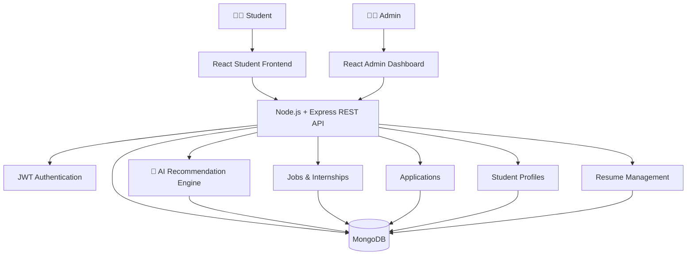

# 🚀 CampusX — AI-Powered Campus Recruitment Platform

<div align="center">


<br />

### 🎓 Connecting Students With Better Career Opportunities

**CampusX is an AI-powered campus recruitment platform that helps students discover relevant jobs and internships while providing administrators with powerful tools to manage the recruitment ecosystem.**

<br />

[🌐 Live Demo](https://campusiq-student-frontend.onrender.com) •
[📂 GitHub Repository](https://github.com/AmarSinghKatiyar/campusIQ)

</div>

---

## 📸 Preview

> Add your screenshots to `docs/screenshots/` and update the paths below.

<div align="center">

### 🎓 Student Dashboard


<br /><br />

### 💼 Job & Internship Discovery


<br /><br />

### 📊 Admin Dashboard


</div>

---

# ✨ What is CampusX?

**CampusX** is a modern campus recruitment platform built to bridge the gap between **students and career opportunities**.

The platform provides students with a centralized place to:

* 👤 Build a professional profile
* 📄 Manage their resume
* 🛠️ Showcase skills and projects
* 💼 Discover jobs and internships
* 🤖 Receive AI-powered recommendations
* 📈 Track applications

Administrators get a dedicated dashboard to manage students, opportunities, applications, and recruitment data.

### 🎯 The Goal

> **Make campus recruitment smarter, simpler, and more accessible.**

---

# ⚡ Features

<table>
<tr>
<td width="50%">

### 👨‍🎓 Student Experience

* 🔐 Secure authentication
* 👤 Professional student profiles
* 📄 Resume upload & management
* 🛠️ Skills & project management
* 💼 Job & internship discovery
* 🤖 AI-powered recommendations
* 📊 Personalized dashboard
* 📈 Application tracking
* 📱 Responsive interface

</td>

<td width="50%">

### 👨‍💼 Admin Experience

* 🔐 Secure admin authentication
* 📊 Recruitment analytics
* 👨‍🎓 Student management
* 💼 Job management
* 📋 Internship management
* 📁 Candidate screening
* 📈 Application monitoring
* ⚙️ Administrative controls
* 🌐 API-driven dashboard

</td>
</tr>
</table>

---

# 🤖 AI-Powered Job Matching

CampusX is designed to make opportunity discovery more personalized.

The recommendation system can use information such as:

```text
Student Profile
      │
      ├── Skills
      ├── Projects
      ├── Academic Profile
      ├── Resume
      └── Career Interests
              │
              ▼
       ┌───────────────┐
       │  AI Matching  │
       └───────┬───────┘
               │
               ▼
      Relevant Opportunities
```

This allows students to discover opportunities that better align with their existing skills, experience, and interests.

---

# 🧩 Feature Highlights

### 🎓 Smart Student Profiles

Create a centralized professional profile containing:

* Personal information
* Academic details
* Technical skills
* Projects
* Achievements
* Career interests

---

### 💼 Jobs & Internships

Students can browse available opportunities and access important information such as:

* Job title
* Company
* Required skills
* Eligibility
* Location
* Description
* Application details

---

### 📄 Resume Management

Students can upload and manage their resumes directly through the platform.

Future versions can extend this into AI-powered resume analysis and optimization.

---

### 📊 Application Tracking

Students can keep track of their recruitment journey from a centralized dashboard.

```text
Applied
   ↓
Under Review
   ↓
Shortlisted
   ↓
Interview
   ↓
Selected / Rejected
```

---

### 📈 Admin Analytics

Administrators can monitor recruitment activity through a centralized dashboard.

Possible insights include:

* Total students
* Active opportunities
* Applications
* Candidate activity
* Recruitment statistics

---

# 🏗️ System Architecture



---

# 🛠️ Tech Stack

## 🎨 Frontend

<div>


</div>

## ⚙️ Backend

<div>


</div>

## ☁️ Deployment

<div>


</div>

---

# 📂 Project Structure

```text
CampusX/
│
├── backend/
│   │
│   ├── admin-backend/
│   │   ├── controllers/
│   │   ├── models/
│   │   ├── routes/
│   │   ├── middleware/
│   │   └── server.js
│   │
│   └── student-backend/
│       ├── controllers/
│       ├── models/
│       ├── routes/
│       ├── middleware/
│       └── server.js
│
├── frontend/
│   │
│   ├── admin/
│   │   ├── src/
│   │   └── package.json
│   │
│   └── student-frontend/
│       ├── src/
│       └── package.json
│
├── docs/
│   └── screenshots/
│
└── README.md
```

---

# 🌐 Live Demo

## 🎓 Student Portal

**Live Application**

👉 https://campusiq-student-frontend.onrender.com

Students can:

* Create profiles
* Manage resumes
* Browse opportunities
* Apply for jobs and internships
* Track applications
* Receive personalized recommendations

---

## 🛠️ Admin Dashboard

**Live Application**

👉 https://campusiq-1-08za.onrender.com

Administrators can:

* Manage students
* Create and manage opportunities
* Review applications
* Monitor recruitment activity
* View dashboard analytics

> ⚠️ **Development Notice:** The admin deployment is currently intended for development/testing. APIs and features may change during development.

---

# 🔑 Demo Credentials

> Replace these credentials with your actual test accounts before publishing.

### 🎓 Student Demo

```text
Email: student@example.com
Password: your_demo_password
```

### 👨‍💼 Admin Demo

```text
Email: admin@example.com
Password: your_demo_password
```

> 🔒 **Security:** Never publish real production credentials or sensitive account information in this README.

---

# 🚀 Getting Started

## Prerequisites

Make sure you have the following installed:

* [Node.js](https://nodejs.org/)
* npm
* MongoDB / MongoDB Atlas
* Git

---

## 1️⃣ Clone the Repository

```bash
git clone https://github.com/AmarSinghKatiyar/campusIQ.git

cd campusIQ
```

---

## 2️⃣ Install Dependencies

### Student Backend

```bash
cd backend/student-backend
npm install
```

### Admin Backend

```bash
cd ../admin-backend
npm install
```

### Student Frontend

```bash
cd ../../frontend/student-frontend
npm install
```

### Admin Frontend

```bash
cd ../admin
npm install
```

---

# 🔐 Environment Variables

Create a `.env` file in the required backend directories.

### Backend

```env
PORT=5000

MONGO_URI=your_mongodb_connection_string

JWT_SECRET=your_secret_key

CLIENT_URL=http://localhost:5173

ADMIN_CLIENT_URL=http://localhost:5174
```

### Frontend

```env
VITE_API_URL=http://localhost:5000
```

> ⚠️ Never commit `.env` files to GitHub.

Add them to `.gitignore`:

```gitignore
.env
.env.local
.env.*.local
```

---

# ▶️ Run Locally

## Student Backend

```bash
cd backend/student-backend
npm run dev
```

---

## Admin Backend

```bash
cd backend/admin-backend
npm run dev
```

---

## Student Frontend

```bash
cd frontend/student-frontend
npm run dev
```

---

## Admin Frontend

```bash
cd frontend/admin
npm run dev
```

---

# ☁️ Deployment

CampusX can be deployed using **Render**.

## Backend Services

### Student Backend

```text
Root Directory:
backend/student-backend

Build Command:
npm install

Start Command:
npm start
```

### Admin Backend

```text
Root Directory:
backend/admin-backend

Build Command:
npm install

Start Command:
npm start
```

---

## Frontend Services

Create two Render Static Sites.

### Student Frontend

```text
Root Directory:
frontend/student-frontend

Build Command:
npm install && npm run build

Publish Directory:
dist
```

### Admin Frontend

```text
Root Directory:
frontend/admin

Build Command:
npm install && npm run build

Publish Directory:
dist
```

Set the frontend environment variable:

```env
VITE_API_URL=https://your-backend.onrender.com
```

---

# 🔐 Security

CampusX uses several security practices including:

* 🔑 JWT authentication
* 🛡️ Protected routes
* 🔒 Password hashing
* 👥 Role-based authorization
* 🌱 Environment variables for secrets
* 🚫 Protected API endpoints

---

# 📡 API Modules

```text
Authentication
├── Register
├── Login
└── Authorization

Student
├── Profile
├── Skills
├── Projects
└── Resume

Recruitment
├── Jobs
├── Internships
├── Applications
└── Recommendations

Administration
├── Student Management
├── Job Management
├── Candidate Screening
└── Analytics
```

---

# 🔮 Roadmap

### 🟢 Current

* [x] Student authentication
* [x] Admin authentication
* [x] Student profiles
* [x] Resume management
* [x] Job listings
* [x] Internship listings
* [x] Application tracking
* [x] Admin dashboard
* [x] AI-based recommendations

### 🔵 Planned

* [ ] 🤖 AI Resume Analyzer
* [ ] 🎤 AI Mock Interview
* [ ] 📧 Automated Email Notifications
* [ ] 💬 Real-Time Chat
* [ ] 🔔 Push Notifications
* [ ] 🏢 Recruiter Portal
* [ ] 📹 Video Interviews
* [ ] 📊 Advanced Recruitment Analytics
* [ ] 🧠 Advanced AI Job Matching

---

# 🤝 Contributing

Although CampusX is primarily a personal project, contributions and suggestions are welcome.

### Fork the repository

```bash
git fork https://github.com/AmarSinghKatiyar/campusIQ.git
```

### Create a feature branch

```bash
git checkout -b feature/your-feature
```

### Commit your changes

```bash
git add .

git commit -m "Add your feature"
```

### Push your branch

```bash
git push origin feature/your-feature
```

Then open a Pull Request.

---

# 📜 License

This project is currently available for educational and demonstration purposes.

Add an appropriate open-source license such as **MIT** if you intend to allow unrestricted reuse and modification.

---

# 👨‍💻 Developer

<div align="center">

### Amar Singh Katiyar

Full-Stack Developer • MERN Stack • AI Applications

[](https://github.com/AmarSinghKatiyar)

</div>

---

# ⭐ Support

If you found **CampusX** useful or interesting, consider giving the repository a ⭐ on GitHub.

It helps support the project and motivates further development.

---

<div align="center">

## 🚀 CampusX

### **Smart Recruitment. Better Opportunities. Stronger Careers.**

Built with ❤️ using the **MERN Stack**

**© 2026 CampusX**

</div>
